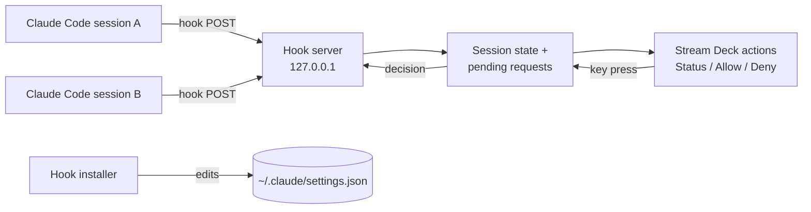

# Claude Deck Architecture

<!-- The current shape of the system across all features. Per-feature technical detail lives in specs/NNN-*/plan.md. The "why" behind choices lives in docs/adr/. Update this when components or their connections change. -->

**Last updated:** 2026-11-17

## Overview
Each Claude Code session posts its hook events (session start, prompt submitted, tool use, notifications, stop, end, and permission requests) as HTTP requests to a small server running inside the Stream Deck plugin on `127.0.0.1`. The plugin keeps one in-memory picture of every session and draws it on the Neo's keys. For a permission request, the server holds the HTTP response open until the owner taps Allow or Deny. Then it replies with the decision, and Claude carries on. If the plugin isn't running, the request can't connect, and Claude shows its normal prompt.

## Components
| Component | Responsibility | Location | Tech |
|-----------|----------------|----------|------|
| Hook server | Receives hook POSTs, checks the token, holds `PermissionRequest` responses open until decided | `src/server/` | Node `http` |
| Core | Session state per `session_id`, queue of pending permission requests, decisions | `src/core/` | Plain TypeScript, no I/O |
| Actions | Status, Allow and Deny keys (and Always Allow later): draw state, handle presses | `src/actions/` | `@elgato/streamdeck` |
| Hook installer | Adds and removes the plugin's own hook entries in `~/.claude/settings.json`, keeping the owner's | `src/core/` (merge logic), `src/plugin.ts` (file I/O) | TypeScript |
| Claude profile | Bundled Neo profile with the keys laid out (capability #4) | `<id>.sdPlugin/profiles/` | Stream Deck profile |

## Data
In memory only, nothing persisted. Sessions are keyed by `session_id`, with the project folder (from `cwd`), state, and last event time. Pending requests are keyed by request, with session, tool name and tool input. Plugin global settings hold the port and per-install token.

## External Integrations
| Service | Used for | Auth | Failure behavior |
|---------|----------|------|------------------|
| Claude Code hooks | Session events and permission decisions | Per-install token in a request header | Plugin down: Claude's normal prompt. Plugin can't decide: return no decision, same fallback |
| Stream Deck app | Hosting the plugin, drawing keys, profile switching | n/a (local SDK socket) | Plugin restarts with the app; sessions re-appear on their next event |

## Cross-Cutting Concerns
- **Auth:** loopback-only bind plus a random token generated on first run, sent by the hooks as a header.
- **Config and secrets:** port and token live in the plugin's Stream Deck global settings; never in the repo.
- **Logging / observability:** the SDK's built-in logger (`streamDeck.logger`), with logs in the plugin's `logs/` folder.
- **Error handling:** fail open to Claude's own prompt; never auto-allow or auto-deny.

## Deployment
Runs locally inside the Stream Deck app on the owner's Windows PC. During development: `streamdeck link` plus `npm run watch`. Release: `streamdeck pack` produces a `.streamDeckPlugin` file to double-click (GitHub release later, capability #7).

## Key Decisions
See `docs/adr/README.md` for the full list.
